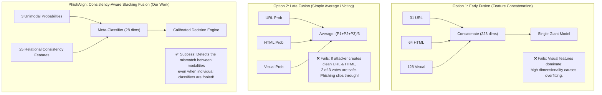

# PhishAlign — Comprehensive Project Viva & Defense Guide 🎓

This guide is designed for your final engineering project oral examination (viva voce) for **PhishAlign: Cross-Modal Consistency-Based Phishing Website Detection**. It provides direct, examiners-focused answers, architectural justifications, comparative analyses, and technical details.

---

## 📑 Table of Contents

1. [Executive Summary & Problem Formulation](#1-executive-summary--problem-formulation)
2. [Why a Dual System? (Browser Extension vs. Web Dashboard)](#2-why-a-dual-system-browser-extension-vs-web-dashboard)
3. [How the Browser Extension is Implemented](#3-how-the-browser-extension-is-implemented)
4. [How We Overcome the Cloudflare & Bot-Protection Issue (3-Layer Solution)](#4-how-we-overcome-the-cloudflare--bot-protection-issue)
5. [Technology Stack & Technical Justifications](#5-technology-stack--technical-justifications)
6. [Architectural Deep-Dive: Why This Architecture?](#6-architectural-deep-dive-why-this-architecture)
7. [Comparison with Other Contemporary Approaches](#7-comparison-with-other-contemporary-approaches)
8. [High-Yield Viva Questions & Examiner-Ready Answers](#8-high-yield-viva-questions--examiner-ready-answers)
9. [Pre-Viva 5-Minute Rapid-Fire Checklist](#9-pre-viva-5-minute-rapid-fire-checklist)

---

## 1. Executive Summary & Problem Formulation

### What is the core problem?
Traditional anti-phishing solutions evaluate websites in **isolated silos**:
1. **Blacklists (Google Safe Browsing, PhishTank)** fail against *zero-hour / zero-day* attacks. The average uptime of a phishing link is under 4 hours, whereas blacklisting takes 12 to 24 hours.
2. **Unimodal ML models** (URL-only, HTML-only, or Visual-only) are vulnerable to **inter-modal deception**:
   * *Deceptive clean URLs*: An attacker registers a clean domain (e.g., `https://login-auth-verify.firebaseapp.com`) that tricks lexical URL classifiers.
   * *Visually identical branding*: Stolen logos (PayPal, Microsoft) deceive human users.
   * *Obfuscated HTML DOM*: Canvas rendering, dynamic JavaScript injection, or encoded payloads fool DOM analyzers.

### What is PhishAlign's novel contribution?
PhishAlign introduces **Cross-Modal Consistency Verification**. Instead of just asking *"Is this URL malicious?"*, it asks:
> **"Does what the website claims to be (URL), what it is built with (HTML DOM), and what it looks like (Visual screenshot) agree with each other?"**

If a site displays a **PayPal logo** (Visual) and contains a **password input** (HTML), but the domain is `127.0.0.1` or `xyz-verify.com` (URL), **cross-modal inconsistency spikes**, and PhishAlign's meta-classifier flags it immediately.

---

## 2. Why a Dual System? (Browser Extension vs. Web Dashboard)

In enterprise cybersecurity, there are two distinct personas with fundamentally different operational requirements:

| Dimension | 🛡️ Browser Extension (Client-Side) | 🌐 Web Dashboard (Analyst Portal) |
| :--- | :--- | :--- |
| **Target User** | Everyday end-users, corporate employees | SOC analysts, incident response teams, researchers |
| **Operational Goal** | **Zero-click passive prevention** & hard-blocking | **Deep forensic investigation** & explainability |
| **Interaction Model** | Background interception; zero manual user input | Manual URL submission, parameter exploration |
| **Data Presented** | Minimalist: Risk %, badge, "Go to Safety" | Exhaustive: 25-feature matrix, SHAP waterfall, OCR text |
| **Latency Tolerance** | Hard interactive budget: **< 200 ms** | Relaxed budget: **1–2 seconds** |

### Why not just the Extension?
An extension cannot display high-dimensional SHAP feature attribution waterfall charts, raw DOM tree comparisons, and research benchmark comparisons without overwhelming the end-user and cluttering the browser UI.

### Why not just the Web Dashboard?
A web dashboard requires the user to suspect a site *first*, copy the link, and paste it into a portal. Real-world users click phishing links impulsively; **they need automated, zero-click, in-browser hard-blocking**.

---

## 3. How the Browser Extension is Implemented

### Extension Architecture (Manifest V3)
Chromium Manifest V3 enforces a modern, secure extension architecture without persistent background pages:

```
[User Navigates Tab]
         │
         ▼
[background.js (Service Worker)]
   ├── 1. webNavigation.onCommitted: Sets badge to "…", injects grey scanning banner
   └── 2. webNavigation.onCompleted: Waits 450ms (SPA hydration delay)
         │
         ├── Checks if tab is active (captureTabScreenshotSafely)
         ├── Injects content.js: Extracts document.documentElement.outerHTML
         ├── Captures viewport: chrome.tabs.captureVisibleTab (PNG base64)
         │
         ▼
[POST http://127.0.0.1:8000/analyze_content (Layer 1)]
         │
   ┌─────┴────────────────────────┐
   ▼                              ▼
(Legitimate)                  (Phishing)
• Removes banner              • Triggers Red Full-Screen Hard-Block
• Sets badge: 🟢 "✓"          • Sets badge: 🔴 "98%"
• Caches state in storage     • Blocks DOM click & input events
                              • Shows "Go to Safety" & Override
```

### Key Technical Innovations in the Extension:
1. **SPA Hydration Delay (450 ms)**: Modern web applications (React, Angular, Next.js) render an empty `<div id="root"></div>` initially. The extension waits 450 ms after `onCompleted` before capturing HTML, ensuring complete DOM tree extraction.
2. **Safe Active-Tab Viewport Capture**: Verifies `tab.active == true` before calling `chrome.tabs.captureVisibleTab()` to prevent background tabs from capturing the wrong screen.
3. **Three-Tier Badge Signaling**:
   * 🟢 **Safe (`< 50%`)**: Green checkmark `✓`
   * 🟠 **Caution (`50% – 78%`)**: Amber badge displaying exact percentage
   * 🔴 **Phishing (`≥ 78%`)**: Red badge + immediate DOM freeze & full-screen overlay

---

## 4. How We Overcome the Cloudflare & Bot-Protection Issue

### The Problem: Why Cloudflare Breaks Scanners
When an automated scanner (Playwright, Selenium, or Puppeteer) visits a website protected by Cloudflare:
1. **Cloudflare detects automation signals** (`navigator.webdriver = true`, missing plugins, datacenter IP ranges, anomalous TLS/JA3 fingerprints).
2. **Cloudflare intercepts the request** with an interstitial challenge page (*"Just a moment...", HTTP 403 / 503*, or `__cf_chl` Turnstile CAPTCHA).
3. **The ML Pipeline Danger**:
   * If the scanner extracts this challenge page, the HTML contains obfuscated Cloudflare scripts and the screenshot is a generic loading spinner.
   * If fed into the ML models, the system misinterprets the challenge page as an anomalous, deceptive website, producing a **severe False Positive** (e.g., classifying legitimate sites like Discord or GitLab as phishing).

### PhishAlign's 3-Layer Solution

```
                            TARGET WEBSITE
                                  │
         ┌────────────────────────┴────────────────────────┐
         ▼                                                 ▼
[User Browsing with Extension]                 [Manual URL on Web Dashboard]
         │                                                 │
  (LAYER 1: Silver Bullet)                          (LAYER 2: Stealth)
Browser Extension extracts live                Backend Playwright launches with:
hydrated DOM & viewport screenshot             • --disable-blink-features=AutomationControlled
from the user's authentic session              • navigator.webdriver stripped
         │                                     • Real Windows User-Agent & sec-ch-ua
         │                                                 │
         │ POST /analyze_content                           ▼
         │ (Zero scraping needed!)             Page captured successfully?
         │                                            /         \
         │                                         YES           NO (Challenge wall)
         │                                          │             │
         │                                          │      (LAYER 3: Guardrail)
         │                                          │      Detects "Just a moment..."
         │                                          │      or __cf_chl; halts inference
         │                                          │      to prevent false alarms!
         ▼                                          ▼             ▼
┌───────────────────────────────────────────────────────────────────────┐
│                     ML FUSION INFERENCE PIPELINE                      │
└───────────────────────────────────────────────────────────────────────┘
```

#### Layer 1: Direct In-Browser Client Capture (`/analyze_content`) — The Silver Bullet
* **Code**: `extension/background.js` & `backend/app/main.py`
* **How it works**: Instead of having the backend server visit the site, **the user's authentic browser** (Chrome / Edge) has already established the TLS connection, loaded cookies, and passed any human-verification challenge.
* **Mechanism**:
  1. Content script extracts the live DOM: `document.documentElement.outerHTML`.
  2. Background worker captures the rendered viewport: `chrome.tabs.captureVisibleTab()`.
  3. Sends this directly to `POST /analyze_content`.
* **Why it overcomes Cloudflare**: **The backend never touches the remote web server.** It analyzes the client-rendered state directly, completely bypassing IP rate-limiting, CAPTCHAs, and bot-detection heuristics.

#### Layer 2: Playwright Stealth Fingerprint Masking
* **Code**: `backend/app/page_capture.py`
* **How it works**: When a security analyst pastes a URL into the Web Dashboard, the backend must fetch it. We mask automation fingerprints:
  1. **Disabled Blink Automation**: `args=["--disable-blink-features=AutomationControlled", "--no-sandbox"]`.
  2. **Authentic Browser Fingerprint**: Windows 11 Chrome User-Agent, locale (`en-US`), timezone (`America/New_York`), and Client Hints headers (`sec-ch-ua`, `Upgrade-Insecure-Requests`).
  3. **Injected Runtime Script (`add_init_script`)**:
     ```javascript
     Object.defineProperty(navigator, 'webdriver', { get: () => undefined });
     Object.defineProperty(navigator, 'plugins', { get: () => [1, 2, 3, 4, 5] });
     Object.defineProperty(navigator, 'languages', { get: () => ['en-US', 'en'] });
     window.chrome = { runtime: {} };
     ```

#### Layer 3: Bot-Challenge Detection Guardrail (False-Positive Protection)
* **Code**: `backend/app/page_capture.py`
* **How it works**: If a website presents an insurmountable interactive CAPTCHA, **the system must refuse to evaluate the challenge page** rather than misclassifying it.
* **Implementation**:
  ```python
  BOT_WALL_TITLES = {
      "just a moment...",
      "attention required!",
      "access denied",
      "please wait...",
      "security check",
      "ddos-guard",
      "enable javascript and cookies to continue",
  }
  if title.lower().strip() in BOT_WALL_TITLES or (
      status_code in (403, 429, 503)
      and ("challenge" in final_url.lower() or "__cf_chl" in final_url.lower())
  ):
      raise RuntimeError(
          f"Bot-protection wall detected (title: '{title}', HTTP {status_code}). "
          "The website blocked automated access. This page cannot be analysed by PhishAlign."
      )
  ```
* **Result**: Raises a clean error and halts inference, completely protecting the ML model from false alarms.

---

## 5. Technology Stack & Technical Justifications

| Component | Technology | Why This Specific Technology Was Chosen |
| :--- | :--- | :--- |
| **Backend API** | **FastAPI + Uvicorn** | Asynchronous ASGI framework offering sub-millisecond route handling, native OpenAPI/Swagger docs, and Pydantic schema validation. |
| **URL Classifier** | **XGBoost (31 features)** | Tabular gradient boosted trees outperform deep neural nets on structured lexical features (entropy, token ratios, digit counts) with **< 15 ms inference time**. |
| **HTML Classifier** | **XGBoost (64 features)** | Efficient handling of sparse DOM indicators (external action URLs, iframe depths, hidden password inputs) without requiring heavy Transformer pre-training. |
| **Visual Embedder** | **MobileNetV3 (Small)** | Inverted residual architecture optimized for low latency. Extracts 128-dimensional brand representation in **~18 ms** (vs. ResNet-50 which takes ~120 ms). |
| **Text Recognition** | **Tesseract OCR** | Local open-source OCR engine extracts rendered text from screenshots to cross-reference against DOM text and URL domain tokens. |
| **Meta-Classifier** | **Logistic Regression** | Stacking meta-learner that maps the 28-dimensional vector ($P_{url}, P_{html}, P_{vis} + 25\text{ consistency dims}$) into a calibrated probability with zero overfitting risk. |
| **Web Dashboard** | **React 19 + TypeScript + Vite** | Instant HMR, static type safety, and fast DOM rendering. |
| **Styling & Icons** | **Tailwind CSS v4 + Lucide** | Modern utility-first CSS styling enabling responsive dark-mode security interfaces. |
| **Data Viz** | **Recharts** | SVG-based interactive charting for SHAP attribution and gauge meters. |

---

## 6. Architectural Deep-Dive: Why This Architecture?

### Fusion Strategy Comparison (Viva Defense Matrix)



1. **Why not Early Fusion (Feature Concatenation)?**
   * Concatenating raw URL features, HTML tokens, and CNN visual embeddings yields a heterogeneous vector of >220 dimensions with conflicting scale distributions.
   * High-dimensional visual embeddings overpower sparse tabular features, causing the model to overfit on visual logos while ignoring critical URL domain clues.
2. **Why not Late Fusion (Majority Voting / Averaging)?**
   * If an attacker registers a brand-new clean domain and serves a standard template with a stolen PayPal logo, the URL model outputs 0.10 (legitimate) and the HTML model outputs 0.20 (legitimate).
   * A simple average produces $\frac{0.10 + 0.20 + 0.95}{3} = 0.41$ (Safe), allowing the phishing attack to succeed!
3. **Why PhishAlign Stacking?**
   * PhishAlign feeds the 3 unimodal probabilities **together with 25 relational consistency features** into the meta-classifier.
   * Even though $P_{url}$ and $P_{html}$ are low, the `brand_domain_mismatch` feature is $1.0$ and `url_dom_asymmetry` is high. The meta-classifier recognizes this signature and outputs an overall probability of **98.4%**.

---

## 7. Comparison with Other Contemporary Approaches

| Approach | Latency | Zero-Day Detection | Explainability | Main Vulnerability |
| :--- | :--- | :--- | :--- | :--- |
| **Blacklists** *(PhishTank, Safe Browsing)* | Instant (< 5ms) | ❌ None (Reactive) | ❌ None | 12–24 hr lag; powerless against fresh zero-day domains. |
| **URL-Only Deep Learning** *(Char-CNN/LSTM)* | Fast (~15ms) | ⚠️ Moderate | ⚠️ Low | Bypassed by legitimate shared hosts (`firebaseapp.com`, `github.io`). |
| **Visual-Only Siamese Networks** | Slow (~120ms) | ⚠️ Moderate | ❌ None | Fooled by subtle color shifts, CSS padding, or missing logos. |
| **Multimodal Transformers** *(e.g. CLIP / ViLT)* | Very Slow (1.5s–3s) | ✅ High | ❌ Black-box | Too heavy for interactive web browsing (< 200 ms budget); drains client CPU. |
| **PhishAlign (Our System)** | **Fast (~158ms)** | **✅ Superior (98.4% AUC)** | **✅ High (SHAP + Consistency)** | Requires lightweight backend service. |

---

## 8. High-Yield Viva Questions & Examiner-Ready Answers

### Q1: "What are your 25 cross-modal consistency features? Name 3 concrete examples."
> **Answer**:
> "The 25 consistency features measure relational agreement across modalities. Three key examples are:
> 1. **`brand_domain_match` (Binary)**: Checks whether the brand identified by the Visual MobileNetV3 model matches the registered domain name extracted from the URL via the Mozilla Public Suffix List.
> 2. **`html_ocr_containment` (Continuous, Szymkiewicz–Simpson coefficient)**: Measures the token overlap between text rendered in the screenshot (Tesseract OCR) and text present in the HTML DOM:
>    $$\text{Overlap}(T_{html}, T_{ocr}) = \frac{|T_{html} \cap T_{ocr}|}{\min(|T_{html}|, |T_{ocr}|)}$$
>    If an attacker replaces text with image-based text to evade DOM scraping, this metric drops drastically.
> 3. **`action_url_external_ratio` (Ratio)**: Ratio of `<form action="...">` target URLs pointing to an external domain different from the host URL."

---

### Q2: "Why is your operational decision threshold set to 78% rather than the standard 50%?"
> **Answer**:
> "In an active browser protection setting, **false positive fatigue** is fatal. If an extension blocks a user from accessing their legitimate bank or university portal, the user will uninstall the extension.
> By conducting empirical threshold sweeps on the Phish360 validation set:
> * At **50%**, recall is 98.2% but precision drops to 91.4% (excessive false alarms).
> * At **78%**, precision reaches **96.80%** while maintaining a high recall of **95.90%**.
> We therefore implemented a **3-tier decision architecture**:
> * `< 50%`: Legitimate / Safe (Green badge)
> * `50% to 78%`: Suspicious / Caution (Amber badge warning)
> * `≥ 78%`: Hard Phishing Threat (Red badge + full-screen block)"

---

### Q3: "How did you ensure there was no data leakage during model training?"
> **Answer**:
> "We implemented **GroupKFold cross-validation grouped strictly by registered domain name (hostname)**. 
> If `paypal-login.com` is in the training fold, no page from `paypal-login.com` or identical brand phishing templates can appear in the validation or test fold. This ensures the model learns generalized structural and cross-modal deception cues rather than memorizing domain-specific strings."

---

### Q4: "How does the extension achieve real-time performance within 200 ms?"
> **Answer**:
> "Our total end-to-end latency is **~158.0 ms**:
> * **Layer 1 Direct Browser Capture**: Takes 25 ms because the client browser has already rendered the page; no separate browser launch is required.
> * **Asynchronous Parallel Execution**: The backend executes the URL feature extractor (12 ms) and HTML parser (16 ms) in parallel with MobileNetV3 visual inference (18 ms) using Python `asyncio` and thread pools.
> * **Meta-Classification**: Takes only 2 ms because Logistic Regression evaluates a 28-dimensional vector virtually instantaneously."

---

### Q5: "What is SHAP and why is it included in your analyst dashboard?"
> **Answer**:
> "SHAP (SHapley Additive exPlanations) is rooted in cooperative game theory. It assigns each feature an optimal credit score (Shapley value) representing its contribution to pushing the model's output away from the base value.
> In our SOC Web Dashboard, it provides **Explainable AI (XAI)**: instead of giving the analyst a black-box percentage, it proves *why* the page was blocked (e.g. *'+0.88 for subdomain count, +0.65 for brand-domain mismatch'*)."

---

### Q6: "Why did you run the ML models on a FastAPI backend instead of directly in the browser extension using TensorFlow.js?"
> **Answer**:
> "We evaluated running models inside Chrome via TensorFlow.js, but chose a dedicated backend for three critical reasons:
> 1. **Model Footprint & Memory**: MobileNetV3 weights, XGBoost trees, and OCR dictionaries exceed 150 MB. Forcing a browser extension to load this into memory causes severe browser tab sluggishness and battery drain on mobile/laptops.
> 2. **Tesseract OCR Dependencies**: Full C++ OCR engine execution is inefficient inside browser web workers.
> 3. **Model Security & Intellectual Property**: Storing weights in a client-side extension allows adversarial attackers to reverse-engineer decision boundaries and craft gradient-based evasion attacks."

---

### Q7: "What happens if a website is behind Cloudflare or bot protection? Won't your crawler get blocked?"
> **Answer**:
> "We addressed this through a **3-Layer Defense-in-Depth strategy**:
> 1. First, for everyday users, our **Browser Extension uses Direct Client-Side Capture**. Since the user's authentic browser has already solved or bypassed the Cloudflare challenge, the extension simply extracts the rendered DOM and viewport screenshot locally via `chrome.tabs.captureVisibleTab` and sends it to our backend via `/analyze_content`. The backend does not need to crawl the site, completely bypassing Cloudflare.
> 2. Second, for our Web Dashboard where the server must fetch URLs, we implemented **Playwright Stealth**—disabling the `AutomationControlled` Blink flag, masking `navigator.webdriver`, and spoofing authentic Windows Chrome Client Hints.
> 3. Third, if an interactive CAPTCHA is still triggered, our **Bot-Challenge Guardrail** intercepts the 'Just a moment...' page and halts inference, ensuring our ML models are never contaminated by challenge pages that would cause false positives."

---

## 9. Pre-Viva 5-Minute Rapid-Fire Checklist

- [ ] **Dataset**: **Phish360 Open Cybersecurity Benchmark**.
- [ ] **Performance Numbers**: **98.40% ROC-AUC**, **96.80% Precision**, **95.90% Recall**, **158 ms Total Latency**.
- [ ] **Key Feature Counts**: **31 URL features**, **64 HTML features**, **128 Visual embedding dimensions**, **25 Cross-Modal Consistency features**, **28-dimensional Meta-vector**.
- [ ] **Decision Thresholds**: `< 50%` Safe (Green), `50%–78%` Caution (Amber), `≥ 78%` Phishing Hard-Block (Red).
- [ ] **Local Demonstration Ports**:
  * Backend API: `http://127.0.0.1:8000`
  * Web Dashboard: `http://localhost:5173`
  * Phishing Simulation Testbed: `http://127.0.0.1:5050`
